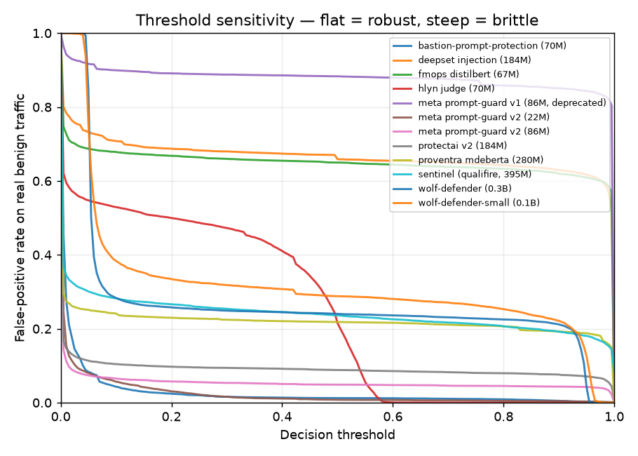
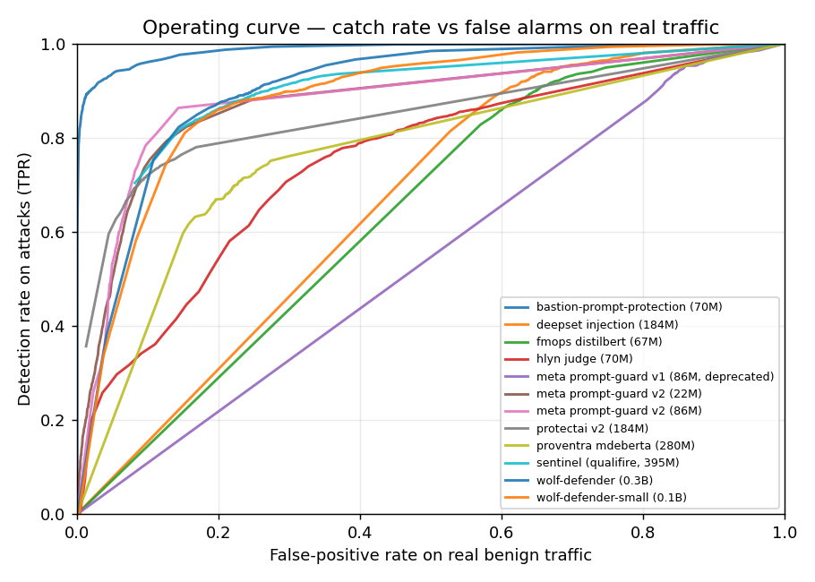

# Reading the results — an honest verdict

This is the interpretation layer for the raw numbers in this folder: *what they
mean across the evaluated detectors, and where even the strongest performers are
weak.* The tables are the evidence; this is the argument. Every number here is
reproducible from the committed per-prompt scores (`scores/`, `scores_indirect/`)
with no GPU — see [METHODOLOGY.md](../METHODOLOGY.md) and [CONTRIBUTING.md](../CONTRIBUTING.md).

> **Disclosure.** This benchmark is maintained by **Bastion Soft**, who also ship one of
> the evaluated detectors (`bastion-prompt-protection`). Every number is reproducible from
> the committed raw scores, every detector is scored through the identical generic path, and
> this document is explicit about where each model — **including Bastion's own** — is weak.
> Be skeptical, and rerun it.

> **Revision 2026-11.** JailbreakBench, CoSafe and AgentHarm were removed (harmful-intent sets
> with no injection mechanism — out of scope); this removed Bastion's own top JailbreakBench
> result (0.986 AUC) from its average. MHJ now has the same turn structure on both sides,
> multi-turn is scored chunked, and loaders are deterministic, so the multi-turn section and
> any indirect set whose rows changed are **pending re-score**. See
> [METHODOLOGY.md → Benchmark revision 2026-11](../METHODOLOGY.md#benchmark-revision-2026-11),
> including the *Known issues* (label noise in rogue, S-Labs and the FP samples) that affect
> the numbers below.

---

## TL;DR

- **Detection:** Bastion leads average ROC-AUC (**0.993**) and F1@0.5 (**0.937**) across the three held-out adversarial benchmarks, but narrowly — wolf-defender is at 0.990 / 0.927. It does **not** win every column (sentinel and wolf-defender beat it on `rogue` AUC; wolf-defender and sentinel beat it on `rogue` F1, wolf-defender on `xTRam1` F1).
- **False positives on real traffic:** **1.24%** at the default threshold — lowest of every detector measured, by a wide margin. This is the axis that breaks detectors in production.
- **The fair, threshold-agnostic comparison** (hold catch-rate constant, compare false alarms): forcing every detector to catch 95% of attacks, Bastion flags **7.81%** of real benign traffic; the next-lowest is meta prompt-guard v2 (86M) at **24.22%**, then wolf-defender at 34.56%.
- **Indirect / structured injection:** over the five sets not pending re-score, Bastion leads average AUC (**0.968** vs next-best 0.917) **and** the within-set false-alarm rate at 95% catch (**10.71%** vs next-lowest 35.52%) — but it has a **real weak spot** on AgentDojo, and BIPIA (previously its other weak spot, 46.0%) is pending re-score (see below).
- **Multi-turn / cross-step:** **pending re-score** under the 2026-11 protocol (chunked scoring, MHJ turn-structure fix). The earlier numbers were withdrawn rather than carried over (§6).
- **What no classifier here can do:** catch domain-specific abuse or tool misuse. A detector is one layer, not the whole defense.

---

## How to read these numbers

A detector outputs a 0–1 risk score per prompt; you pick a **threshold** (line) above which you block. Three families of metric, measuring different things:

- **ROC-AUC** — *threshold-free.* How well the detector **ranks** attacks above benign across every possible line. The "how good is it really" number; can't be gamed by threshold choice.
- **F1 / FPR at a fixed threshold (0.5)** — *operating-point.* How it behaves **out of the box** if you don't tune. Realistic (most people never tune), but unfair to detectors whose scores happen to cluster near 0.5.
- **FPR at a fixed detection rate / EER** — *threshold-agnostic, fair.* Tune each detector to the **same catch rate**, then compare the false-alarm cost. Removes the "where's the line" objection entirely.

Two reading rules used throughout: **averages are unweighted** (S-Labs test, n=2,000, counts as much as rogue, n=5,000 — read the per-column numbers), and **small sets are noisy**.

---

## 1. Detection — does it catch attacks?

Average ROC-AUC across three held-out benchmarks (full table: [`leaderboard.md`](leaderboard.md)):

| | Avg AUC | Avg F1@0.5 |
|---|---|---|
| **bastion (70M)** | **0.993** | **0.937** |
| wolf-defender (0.3B) | 0.990 | 0.927 |
| wolf-defender-small (0.1B) | 0.984 | 0.921 |
| sentinel (395M) | 0.975 | 0.904 |
| … | … | … |

With JailbreakBench gone the top four are within 0.02 AUC of each other: Bastion leads the mean, but **not every cell** — sentinel wins `rogue` (0.995 AUC) and wolf-defender wins `xTRam1` F1 (0.976). Ranking is the easy part on these sets; the axes below are where detectors separate. Read the columns, not just the average.

---

## 2. False positives on real traffic — does it stay out of the way?

The axis most comparisons skip, and the one that turns a detector into an outage. Share of **genuine benign** messages (WildChat + LMSYS first-user turns) wrongly flagged at the common 0.5 threshold (full table: [`false_positives.md`](false_positives.md)):

| | FPR @ 0.5 |
|---|---|
| **bastion (70M)** | **1.24%** |
| protectai v2 (184M) | 8.82% |
| hlyn judge (70M) | 21.53% |
| sentinel (395M) | 23.60% |
| wolf-defender (0.3B) | 24.03% |
| … meta prompt-guard | 88.30% |

The detection ranking **inverts** here: the four detectors closest to Bastion on AUC (both wolf-defenders, sentinel, hlyn — all 0.956–0.990) flag **22–29%** of real users at this operating point. (Part of every detector's FPR here is label noise — the samples contain real jailbreak attempts and a heavily repeated LMSYS scaffold; see the Known issues in METHODOLOGY.md.) A support assistant that refuses one in four genuine messages is switched off within a day, and its 0.95 AUC won't save it.

---

## 3. The fair comparison — false positives at a fixed catch rate

A fixed 0.5 line is arbitrary and isn't equally fair to every detector. The decisive comparison holds the thing buyers actually want — **attacks caught** — constant, and compares the cost. Tune each detector to catch **95% / 99%** of attacks, then measure FPR on **real benign traffic** (full data: [`operating_points.md`](operating_points.md)):

| | FPR @ 95% catch | FPR @ 99% catch | EER |
|---|---|---|---|
| **bastion (70M)** | **7.81%** | **23.35%** | **4.6%** |
| meta prompt-guard v2 (86M) | 24.22% | 53.11% | 17.6% |
| wolf-defender (0.3B) | 34.56% | 54.92% | 5.2% |
| wolf-defender-small (0.1B) | 43.51% | 68.86% | 6.9% |
| sentinel (395M) | 44.18% | 100.00% | 5.0% |
| … protectai v2 | 54.78% | 100.00% | 18.8% |

Letting every competitor use its own threshold to reach the same 95% catch rate, Bastion flags about **3×** less real benign traffic than the next-lowest detector (meta prompt-guard v2 86M, whose EER of 17.6% shows it ranks attacks much less well) and **4.4×** less than wolf-defender, the closest detector on AUC.

It also exposes what the 0.5 table hides: **a low false-positive rate at 0.5 can be bought by under-catching.** protectai looks moderate at 0.5 (8.82%) but only catches 70.4% of attacks there; to reach 95% it flags 54.78% of real benign traffic.

> **Bastion's own caveat:** its FPR rises from **1.24% (at 0.5)** to **7.81% (at 95% catch)** — because at 0.5 it catches ~89% of attacks, not 95%; the extra 6 points of recall cost false positives. The fair comparison is a *harder* bar than the headline FPR — 7.81% is the honest number for "catch 95% of everything."

### The graphs

**Threshold sensitivity — flat = robust, steep = brittle.** FPR on real benign traffic as the decision threshold moves:

Bastion (bold) hugs the floor near 0% across almost the entire range — its score distribution is so well-separated that the exact threshold barely matters. Most competitors sit on a high plateau (they flag a large, roughly constant share of benign no matter the line). **hlyn is the steep cliff** — its FPR swings from ~50% to ~0% over a narrow band, which is exactly why its single 0.5 number is so misleading (see §4).

**Operating curve — catch rate vs false alarms on real traffic.** The false-positive-axis companion to the ROC: for any detection rate you require (y), how much real benign traffic you flag to get there (x):

A detector in the top-left corner catches attacks while sparing users. Bastion's curve rises almost vertically — high catch rates at tiny false-alarm cost — while the others need to move far right (flag lots of benign) to climb.

---

## 4. The hlyn judge case — high AUC is not the same as usable

hlyn deserves its own note because its numbers are easy to misread (and it is now **gated** on HF — its row is reproduced from committed scores). It posts a strong **0.956 AUC** and a middling **21.53% FPR@0.5**, which looks like a decent detector with a slightly aggressive threshold. The threshold-agnostic data says otherwise:

- At 0.5 it catches **only 58.0%** of attacks (it hedges — its scores cluster in a narrow band around 0.5, topping out ~0.55).
- To catch 95% of attacks it floods **77%** of real benign traffic (worse than at 0.5).
- So **hlyn has no usable operating point on real traffic** — there is no threshold where it both catches attacks and spares users.

Its high AUC reflects ranking on the *benchmark* benign data; that separation **does not transfer** to real chat traffic, where its scores overlap heavily with benign. This is the difference between "ranks well in the lab" and "works in production," and it's why this document leads with the fair comparison rather than AUC alone.

---

## 5. Indirect / structured injection

Injection hidden inside the *data* an app trusts — JSON tool results, documents, agent interactions. A distinct capability axis, reported separately (competitors aren't built for it). Average AUC (full: [`indirect.md`](indirect.md)) and within-set false-alarm rate at 95% catch on **benign structured records** (full: [`operating_points_indirect.md`](operating_points_indirect.md)):

| | Avg AUC | Avg FPR @ 95% catch |
|---|---|---|
| **bastion (70M)** | **0.968** | **10.71%** |
| wolf-defender (0.3B) | 0.917 | 37.53% |
| meta prompt-guard v2 (86M) | 0.813 | 35.52% |
| … | … | … |

Averages are over five sets: **BIPIA is pending re-score** (its loader read files in filesystem order; the committed scores were computed on table → email → code order, the now-sorted loader yields code → email → table, and attacks are assigned by row index, so the rows themselves changed). Before the revision BIPIA was one of Bastion's two weakest indirect sets (46.0% FPR at 95% catch), so dropping it from the average flatters Bastion until the re-score lands — read the averages with that in mind.

Bastion leads both axes here. **But this is genuinely uneven, and the average hides it** — per set, Bastion's false-alarm rate at 95% catch is:

| zedgar | injecagent | hackaprompt | tensortrust | **agentdojo** | bipia |
|---|---|---|---|---|---|
| 0.00% | 0.00% | 0.00% | 10.25% | **43.30%** | pending re-score |

On Z-Edgar, InjecAgent, and HackAPrompt it catches the injection essentially without touching benign structured data. On **AgentDojo (43.3%)** it cannot cleanly separate injected from benign structured records at a high catch rate — a real limitation worth naming. It is still the best of the field on that set, but "best" here is not "solved."

---|---|---|
| **bastion (70M)** | **0.952** | **16.59%** |
| wolf-defender (0.3B) | 0.865 | 45.78% |
| deepset injection (184M) | 0.787 | 49.05% |
| … | … | … |

Bastion leads both axes here. **But this is genuinely uneven, and the average hides it** — per set, Bastion's false-alarm rate at 95% catch is:

| zedgar | injecagent | hackaprompt | tensortrust | **agentdojo** | **bipia** |
|---|---|---|---|---|---|
| 0.00% | 0.00% | 0.00% | 10.25% | **43.30%** | **46.00%** |

On Z-Edgar, InjecAgent, and HackAPrompt it catches the injection essentially without touching benign structured data. On **BIPIA (46.0%)** and **AgentDojo (43.3%)** it cannot cleanly separate injected from benign structured records at a high catch rate — a real limitation worth naming. It is still the best of the field on these sets, but "best" here is not "solved."

---

## 6. Multi-turn / cross-step injection

**Pending re-score.** The 2026-11 revision changed this axis in three ways at once: CoSafe and
the agent-jailbreak family (AgentHarm) were removed as out of scope; MHJ is now rendered with
the same turn structure on both sides (its attacks have no assistant turns, the benign pool
did, so "has an assistant turn" alone separated the labels perfectly); and every set is scored
with `--chunk`, so a detector reads the whole conversation instead of only the most recent
window. The InjecAgent multi-turn loader also became deterministic. The previous numbers —
including the cross-step depth cliff for 512-token detectors such as Bastion and the MHJ +
CoSafe jailbreak ranking Bastion led — were measured under the old rows and protocol and are
withdrawn rather than carried over. [`multiturn.md`](multiturn.md) shows every cell as
*pending re-score* until
[`notebooks/rescore_revision_2026_11.ipynb`](../notebooks/rescore_revision_2026_11.ipynb) has
re-scored all twelve detectors; this section is rewritten from those results.

What carries over is the design: two families (jailbreak, cross-step) reported separately;
matched injected/benign pairs; recall stratified by injection depth (cross-step) and
conversation length (jailbreak); each model's window reported. With chunked scoring, a drop
with depth is a detection limit rather than a window limit.

---

## 7. What these classifiers fundamentally cannot catch

A detector — any detector here — only recognizes the *patterns it was trained on*. It is one layer, and these are out of scope for all of them:

- **Domain-specific abuse.** "Give me a 100% discount" or "I want a $50 coupon" is ordinary user language; no injection detector should (or will) block it. Whether a discount is granted is a job for your business logic, not a prompt classifier.
- **Multi-step / context attacks** — *measured, with limits.* A single message scored in isolation has no conversation state. When the filter is fed the **whole conversation**, catching it becomes a detection question — that's the multi-turn axis (§6). Under plain truncation detection only holds within the model's context window; chunked scoring (the published protocol since 2026-11) reads every window, at the cost of more forward passes and some extra false positives on long benign conversations.
- **Tool misuse.** "Check every reference in my résumé" may be a reasonable request or a DoS-style overload, depending on user, context, and limits. Tool/token budgets are infrastructure concerns, not detection ones.
- **Probabilistic, not deterministic.** Unlike antivirus signatures, these are statistical models — even on attacks they were trained on they approach, but never guarantee, 100% reliability. And a brand-new exploit discovered tomorrow won't be in any model's training set, which is why a maintained, continuously-updated detector matters.

Treat a detector as defense-in-depth, alongside schema validation, authorization, rate limits, and least-privilege tools — not as the whole wall.

---

## Caveats & reproducibility

- **Same policy for everyone.** Detection is out-of-domain on three held-out sets; the fixed-threshold metrics use 0.5 for every detector, Bastion included. No per-model tuning. The operating-point analysis then removes the threshold dependence entirely.
- **Competitor numbers are not bit-stable across GPU runs.** The torch baselines vary slightly run-to-run (most visibly on small sets and on models sitting near AUC 0.5); Bastion's quantized ONNX path is deterministic. To remove any ambiguity, **every number in this folder is recomputed offline from the committed per-prompt scores** (`scores/`, `scores_indirect/`) via `python -m scripts.rebuild_results_from_scores` and `scripts.analyze_operating_points` — so the leaderboard, FPR, indirect, and operating-point tables are mutually consistent and reproducible by anyone, no GPU required. Re-running the Colab regenerates the scores (to within that run-to-run noise) and the rankings/story are unchanged; the exact published decimals are pinned by the committed scores, not by trusting a GPU run.
- **meta prompt-guard** (0.301 AUC / 88% FPR) is kept in for completeness. It is not a harness error — its attack recall is 95.8%, so the polarity is correct; it simply flags almost everything. It is Meta's deprecated v1 model (replaced by Prompt-Guard-2) and over-fires by design; read it as "wrong tool, shown for context," not a fair head-to-head.
- **Held out from training.** Every set scored here is held out from Bastion's training data — that's the contract behind the numbers, and why they reproduce from public weights. For the multi-turn sets (which share behavior seeds with common training corpora), Bastion self-audited its own corpus for overlap and found **≈0% verbatim** contamination; the rendered conversations are novel text even where a seed behavior overlaps.
- **Multi-turn reproduces the same way.** Per-conversation scores + metadata are committed (`scores_multiturn/`); `python -m scripts.analyze_multiturn` rebuilds the family tables and depth/length cuts with no GPU. Score files are checked against their rows (revision stamp + row fingerprint); files that predate the 2026-11 loader changes are shown as pending, never re-aligned.

_Direct/indirect numbers regenerated from committed scores; multi-turn generated 2026-07-03. Rerun any table from `scores/`, `scores_indirect/`, or `scores_multiturn/` — no GPU._
